<p align="center">
  <picture>
    <source media="(prefers-color-scheme: dark)" srcset="docs/brand/mark.dark.svg">
    
  </picture>
</p>

<h1 align="center">PR Lens</h1>

<p align="center"><a href="README.md">English</a> · 简体中文</p>

> 本文为简体中文译文；最新说明以[英文 README](README.md)为准。命令和配置示例保留英文原文。

<p align="center">
  <b>先通过图示了解拉取请求、代码库或软件，再阅读具体代码</b><br>
  PR Lens 将拉取请求画成动态架构图和数据流图，<br>
  并作为评论发布到拉取请求中。编码智能体也可以连接实时画布，通过动画讲解帮助你理解代码库和代码改动。
</p>

<p align="center">
  <a href="https://github.com/apps/coldtea-pr-lens"></a>
  <a href="https://www.npmjs.com/package/@coldtea/pr-lens-cli"></a>
  <a href="https://discord.gg/nTEFnmBQMJ"></a>
  <a href="https://prlens.dev"></a>
  <a href="LICENSE"></a>
</p>

<h3 align="center"><a href="https://github.com/apps/coldtea-pr-lens">安装 GitHub App</a>&nbsp;&nbsp;·&nbsp;&nbsp;<a href="https://skills.sh/coldteadotai/pr-lens">安装 Skill</a></h3>

<p align="center">
  <sub>也支持 <a href="https://prlens.dev/gitlab">GitLab</a> 和 <a href="https://prlens.dev/bitbucket">Bitbucket</a></sub>
</p>

<p align="center">
  <sub>开源项目免费 &nbsp;&nbsp;·&nbsp;&nbsp; 也可以让编码智能体绘图： <code>npx skills add coldteadotai/pr-lens</code></sub>
</p>

<p align="center">
  <picture>
    <source media="(prefers-color-scheme: dark)" srcset="docs/brand/cta-strip.dark.svg">
    
  </picture>
</p>

<picture>
  <source media="(prefers-color-scheme: dark)" srcset="docs/showcase/teaser.comment.dark.svg">
  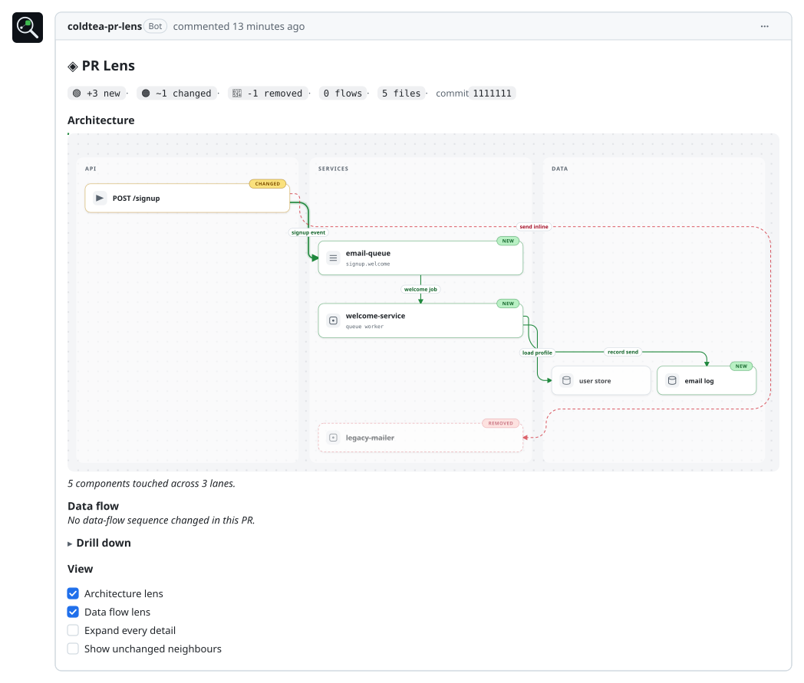
</picture>

<br />

## 功能

<table>
<tr>
<td width="46%" valign="middle">

### 自定义动画渲染器

我们从零构建了自定义渲染器，用动画图示呈现代码的新增、删除和修改，帮助读者理解复杂改动，也能展示大型系统。

</td>
<td width="54%" valign="middle">
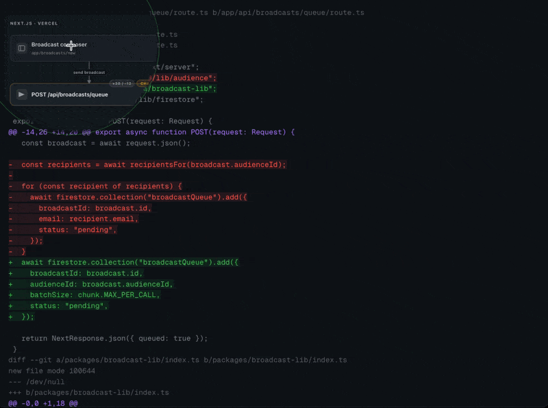
</td>
</tr>

<tr>
<td width="46%" valign="middle">

### 改动影响的架构范围

图中会标出代码改动涉及的系统模块，以及周围的组件和它们之间的调用关系。

颜色表示改动类型：**绿色**表示新增，**琥珀色**表示修改，**红色**表示删除。

</td>
<td width="54%" valign="middle">
<picture>
  <source media="(prefers-color-scheme: dark)" srcset="docs/showcase/tier2-reference.architecture.dark.svg">
  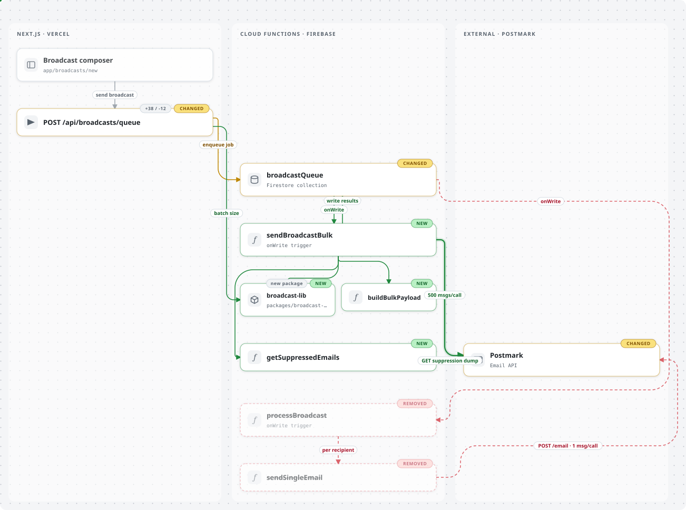
</picture>
</td>
</tr>

<tr>
<td width="46%" valign="middle">

### 按顺序查看数据流

查看数据如何在代码库或本次改动中流转。图中的移动圆点会依次演示每个步骤。

</td>
<td width="54%" valign="middle">
<picture>
  <source media="(prefers-color-scheme: dark)" srcset="docs/showcase/reference.data-flow.dark.svg">
  
</picture>
</td>
</tr>

<tr>
<td width="46%" valign="middle">

### 查看数据流携带的内容

点击任意箭头，即可在图旁的面板中查看请求和响应。面板会展示预期的数据结构或示例，并沿用图中的颜色：新增字段为绿色，删除字段为红色。

</td>
<td width="54%" valign="middle">
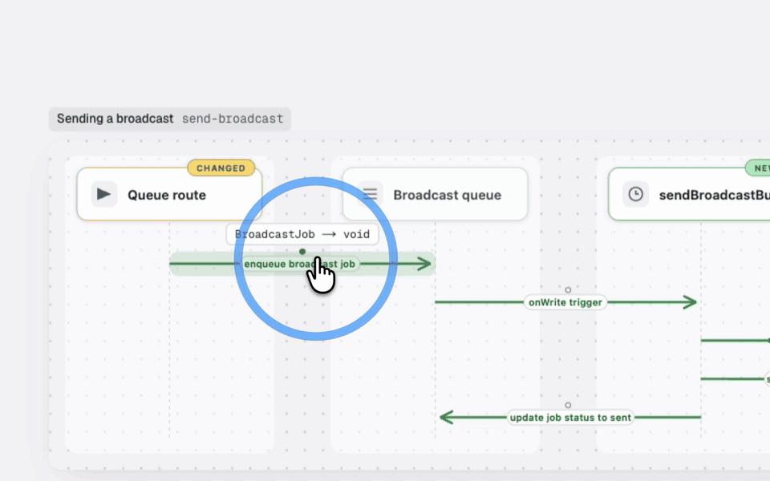
</td>
</tr>

<tr>
<td width="46%" valign="middle">

### 在当前页面展开细节

评论包含可展开和收起的区域（`<details>`），每个区域用一张图展示部分改动。顶部先展示整体变化，下面依次展示新增路径和已删除的部分。

</td>

<td width="54%" valign="middle">
<picture>
  <source media="(prefers-color-scheme: dark)" srcset="docs/showcase/reference.new-batch-path.dark.svg">
  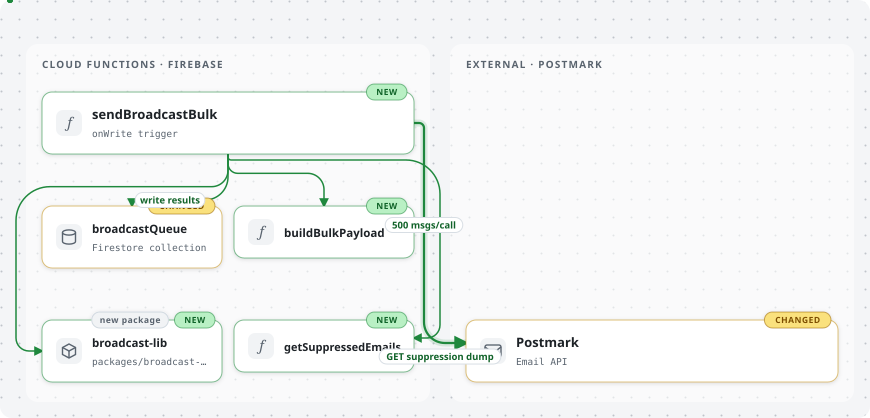
</picture>
</td>
</tr>

<tr>
<td width="46%" valign="middle">

### 交互画布

每条评论或绘图都可以链接到交互画布。画布以完整尺寸展示同样的图，支持平移、缩放和明暗主题切换，为大型改动提供更充足的查看空间。

</td>
<td width="54%" valign="middle">
<a href="https://prlens.dev/c/uSdxMcPBFwhfgfaGh-dveQ"></a>
</td>
</tr>

<tr>
<td width="46%" valign="middle">

### 逐步讲解改动

PR Lens 提供称为 walkthrough 的动画讲解，带你逐步了解系统或代码改动。点击画布上的播放按钮，或按 W 键即可开始。

</td>
<td width="54%" valign="middle">
<a href="https://prlens.dev/c/uSdxMcPBFwhfgfaGh-dveQ"></a>
</td>
</tr>

<tr>
<td width="46%" valign="middle">

### 让智能体连接实时画布

让本地编码智能体连接画布，协助你理解代码库或代码改动。你可以继续提问、放大图中的任意部分，或框选几张卡片让智能体解释；画布会实时呈现它的讲解。

</td>
<td width="54%" valign="middle">
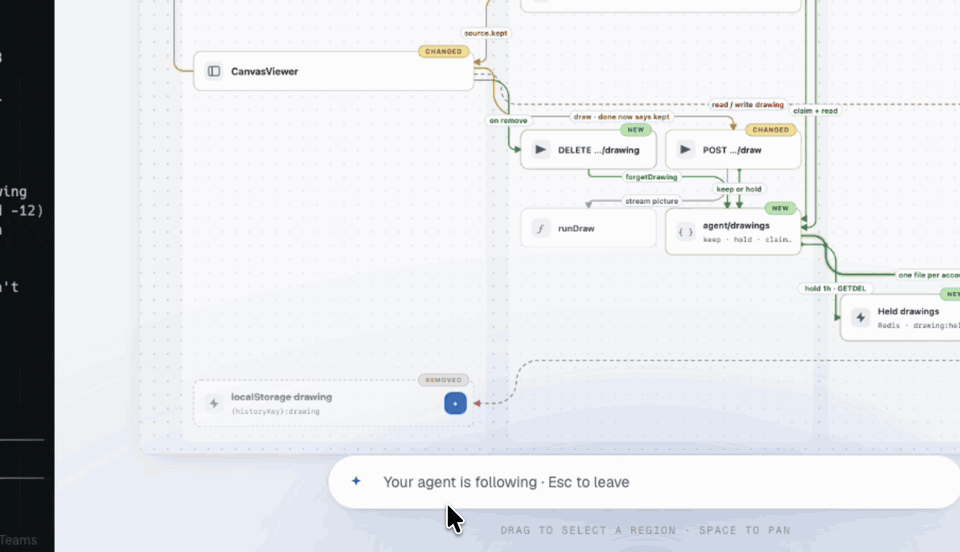
</td>
</tr>

<tr>
<td width="46%" valign="middle">

### 从单张卡片到整个 monorepo

不同规模的改动使用同一套表达方式：泳道、卡片、表示改动的颜色，以及便于追踪的连线路径。

不过，实际提交时还是建议把这么大的拉取请求拆小。

</td>
<td width="54%" valign="middle">
<picture>
  <source media="(prefers-color-scheme: dark)" srcset="docs/showcase/tier5-monorepo.architecture.dark.svg">
  
</picture>
</td>
</tr>

<tr>
<td width="46%" valign="middle">

### 明暗主题

通过 GitHub App 生成的每张图都有明暗两个版本，GitHub 会根据读者的主题显示对应版本。你也可以在本地让编码智能体生成任一主题的图。

</td>
<td width="54%" valign="middle">
<p align="center">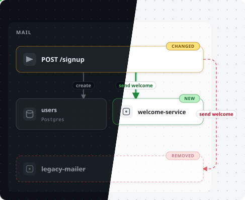</p>
</td>
</tr>

<tr>
<td width="46%" valign="middle">

### GitHub、GitLab 和 Bitbucket

PR Lens 支持这三个平台。在 GitHub 上安装 App；在 GitLab 流水线中添加 CI/CD 组件；在 Bitbucket 中添加 pipe。

查看 [GitLab](https://prlens.dev/gitlab) 或 [Bitbucket](https://prlens.dev/bitbucket) 的配置方法。

</td>
<td width="54%" valign="middle">
<p align="center">
  <picture>
    <source media="(prefers-color-scheme: dark)" srcset="docs/brand/forges.dark.svg">
    
  </picture>
</p>
</td>
</tr>

</table>

<br />

## 经典 PR 图解

我们用 PR Lens 重新绘制了引入 React Hooks、Node fetch 和 Kubernetes Ingress 的拉取请求，使用的渲染器和格式与上面的图相同。

<a href="https://prlens.dev/gallery/react/react/13968">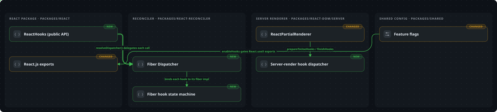</a>

<sub><b><a href="https://prlens.dev/gallery/react/react/13968">react/react#13968</a></b> · 36 个文件 · +5,868/−130 · 5 条泳道。通过特性开关引入 Hooks。</sub>

<a href="https://prlens.dev/gallery/nodejs/node/41749">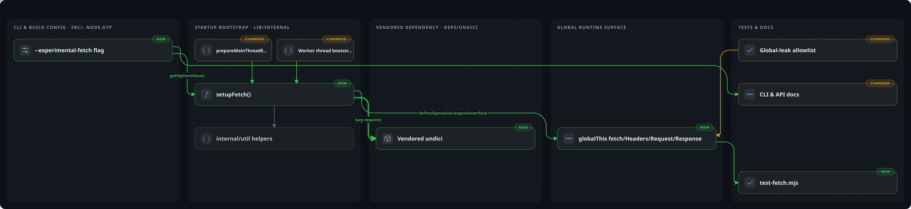</a>

<sub><b><a href="https://prlens.dev/gallery/nodejs/node/41749">nodejs/node#41749</a></b> · 16 个文件 · +8,076/−3 · 5 条泳道。为 Node 本身加入 `fetch`、`Request`、`Response` 和 `Headers`。</sub>

<a href="https://prlens.dev/gallery/kubernetes/kubernetes/14175">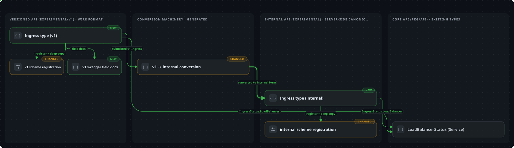</a>

<sub><b><a href="https://prlens.dev/gallery/kubernetes/kubernetes/14175">kubernetes/kubernetes#14175</a></b> · 8 个文件 · +766/−0 · 4 条泳道。首次加入用于七层负载均衡的 Ingress 类型。</sub>

<details>
<summary><b>另七个案例</b> · Vue, Rust, Tokio, Neovim, Django, webpack, vLLM</summary>
<br>

<a href="https://prlens.dev/gallery/vuejs/core/2532">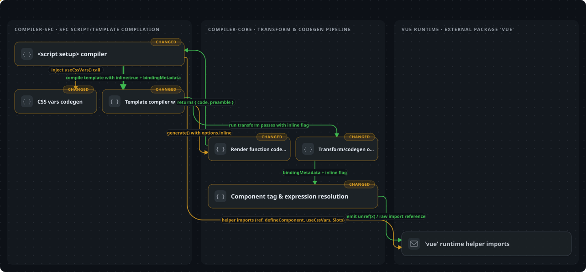</a>

<sub><b>vuejs/core#2532</b> · 11 个文件 · +1,081/−670 · 3 条泳道。引入 `&lt;script setup&gt;` 和最初版本的 ref 语法糖。</sub>

<a href="https://prlens.dev/gallery/rust-lang/rust/31954">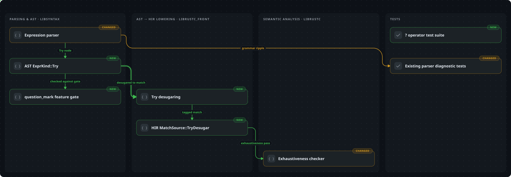</a>

<sub><b>rust-lang/rust#31954</b> · 26 个文件 · +369/−16 · 4 条泳道。引入 `?` 运算符，用更简洁、可链式使用的写法替代 `try!`。</sub>

<a href="https://prlens.dev/gallery/tokio-rs/tokio/1657">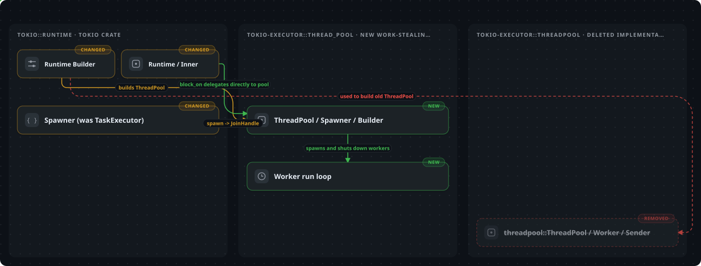</a>

<sub><b>tokio-rs/tokio#1657</b> · 100 个文件 · +7,408/−6,795 · 3 条泳道。重写工作窃取线程池，减少调度器的额外开销。</sub>

<a href="https://prlens.dev/gallery/neovim/neovim/11336">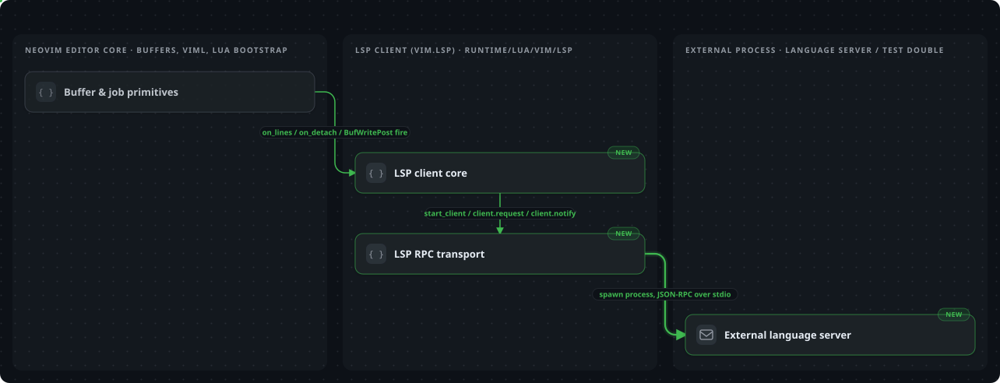</a>

<sub><b>neovim/neovim#11336</b> · 15 个文件 · +5,556/−1 · 3 条泳道。将 LSP 客户端纳入 Neovim 本身。</sub>

<a href="https://prlens.dev/gallery/django/django/11209">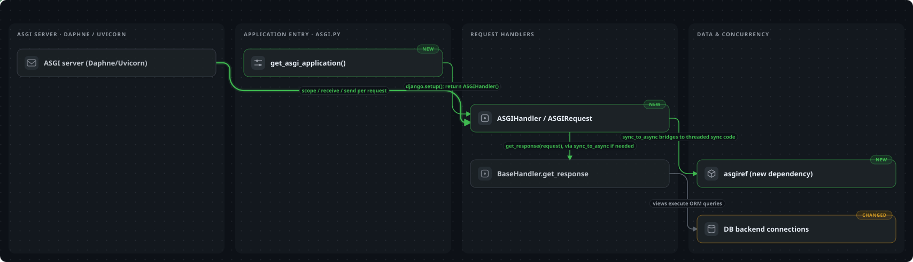</a>

<sub><b>django/django#11209</b> · 38 个文件 · +931/−42 · 5 条泳道。加入 ASGI 处理器和可在协程中安全使用的请求上下文。</sub>

<a href="https://prlens.dev/gallery/webpack/webpack/10440">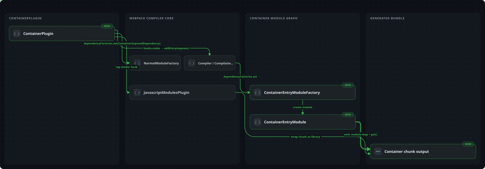</a>

<sub><b>webpack/webpack#10440</b> · 13 个文件 · +567/−5 · 5 条泳道。通过 `ContainerPlugin` 引入模块联邦。</sub>

<a href="https://prlens.dev/gallery/vllm-project/vllm/1348">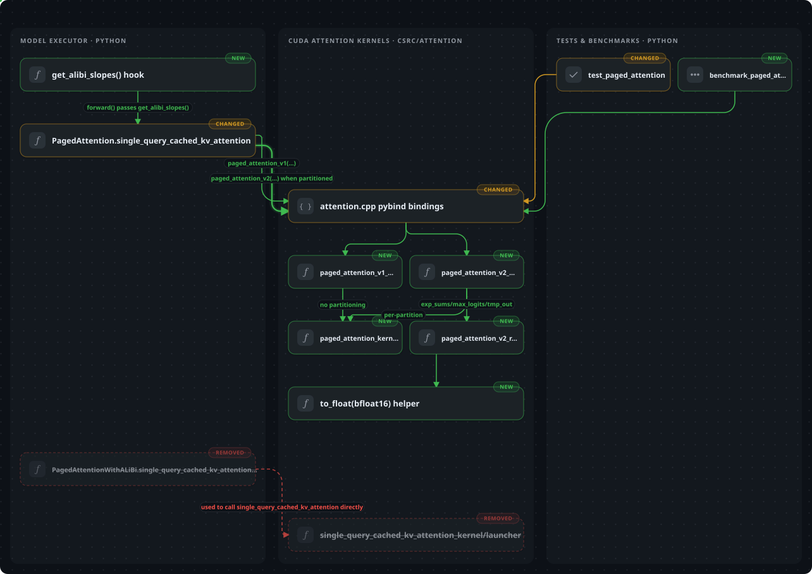</a>

<sub><b>vllm-project/vllm#1348</b> · 6 个文件 · +764/−139 · 3 条泳道。引入 PagedAttention V2 及其序列级并行能力。</sub>

</details>

<b><a href="https://prlens.dev/gallery">查看全部经典案例</a></b>。 所有案例都可以打开交互查看。

<br />

## 配置

通过 `.github/pr-lens.yml` 调整 PR Lens 的行为。GitLab 和 Bitbucket 没有 `.github/` 目录时，也可以使用 `.gitlab/pr-lens.yml` 或仓库根目录的 `pr-lens.yml`，作用相同。[配置参考](packages/schema#repository-config)列出了各项设置、默认值和示例。

### 修正名称和绘图问题

使用 CLI 绘图时，把修正写入 `.github/pr-lens.yml`，不要直接编辑生成的 SVG 文件：

```yaml
schemaVersion: 0.1.0
map:
  rename:
    - match: services/legacy-mailer.ts
      to: Postmark sender
  exclude:
    - "**/*.test.ts"
```

这些修正会覆盖在模型分析结果之上，代码变化或模型在不同运行中采用不同名称时仍然有效。你可以重命名组件、排除文件、将卡片固定到指定泳道，或把相关内容分组。完整说明见 [`packages/cli`](packages/cli#corrections)。

<br />

## 其他运行方式

多数用户使用 App 即可。需要在自己的 CI 中运行、使用自己的模型，或在创建拉取请求前绘图时，可以选择下面的方式。

<details open>
<summary><b>通过编码智能体</b></summary>
<br>

在创建拉取请求之前，智能体就可以使用同一套渲染器，帮你理解代码库或检查它自己的改动。系统逐渐变大时，也可以用它持续梳理系统结构。

<p align="center">
  <picture>
    <source media="(prefers-color-scheme: dark)" srcset="docs/brand/agents.dark.svg">
    
  </picture>
  <br>
</p>

```bash
npx skills add coldteadotai/pr-lens
```

然后向编码智能体提出类似这样的请求：

> 用 PR Lens 画出你刚完成的改动，并把图附到拉取请求中。

智能体读取 diff 并编写图文档，然后运行 `npx @coldtea/pr-lens-cli validate`，直到文档通过所有检查。接着生成图，并用 `gh pr create --attach` 将其加入拉取请求描述，创建 PR 时即可看到。如果图中的名称有误，Skill 会指导智能体修改 `.github/pr-lens.yml`，而不是编辑生成的文件。详情见 [`packages/agent-skill`](packages/agent-skill)。

也可以把下面的提示词交给智能体，让它协助完成配置：

```text
Set up PR Lens for me. It draws code changes as moving diagrams of the system and how data flows through it.

1. Install the agent skill: `npx skills add coldteadotai/pr-lens`.

2. Help me install the GitHub App at https://github.com/apps/coldtea-pr-lens on every repository where I review pull requests. It posts one comment per pull request and updates that comment on every push. It does not need a model key from me.

3. If I'd rather run it from CI with my own model key, offer the Action instead: `.github/workflows/pr-lens.yml` using `coldteadotai/pr-lens/packages/action@v0`, with the key saved as a repository secret. It works with any service that speaks `/chat/completions`, such as OpenAI or Gemini.

4. Then test it: diagram the latest change in this repository and show me the SVGs or the canvas.
```

</details>

<details>
<summary><b>作为工作流：GitHub Action</b> · 自己的 CI · 自己的密钥 · 静态评论</summary>
<br>

这种方式在你自己的 CI 中使用自己的模型密钥绘图并发布评论。先把密钥保存为仓库 Secret。下面的示例使用 `GEMINI_API_KEY`，因为 `provider` 默认是 Gemini。将以下内容保存为 `.github/workflows/pr-lens.yml` 并提交：

```yaml
name: PR Lens

on:
  pull_request:

permissions:
  contents: write # to publish the rendered SVGs
  pull-requests: write # to post the comment

concurrency: # one run per pull request; a push supersedes the last
  group: pr-lens-${{ github.event.pull_request.number }}
  cancel-in-progress: true

jobs:
  lens:
    runs-on: ubuntu-latest
    steps:
      - uses: actions/checkout@v4
        with:
          fetch-depth: 0 # the diff is between two commits, so both must be here
      - uses: coldteadotai/pr-lens/packages/action@v0
        with:
          api-key: ${{ secrets.GEMINI_API_KEY }}
```

你可以选择不同模型。`provider` 支持 `gemini`（默认）、`openai`，也支持配合 `base-url` 和 `model` 使用 `openai-compatible`，因此同一套工作流可以接入 OpenRouter、DeepSeek 或自己的服务。密钥通过环境变量传给 CLI，不出现在命令行参数中；diff 只发送给你选择的提供商。Action 无法在运行之间保留交互状态，因此发布的是静态评论，复选框交互仅适用于 App。提供商、视图（lens）、品牌设置和其他输入见 [`packages/action`](packages/action)。

</details>

<details>
<summary><b>在 GitLab 上：CI/CD 组件</b> · 自己的流水线 · 自己的密钥 · 可更新的评论</summary>
<br>

GitLab CI 可以在合并请求中发布同样的图。添加两个 Masked 变量：模型密钥，以及具有 `api` 权限范围的项目访问令牌；后者用于发布评论。然后添加该组件：

```yaml
workflow:
  rules:
    - if: $CI_PIPELINE_SOURCE == "merge_request_event"
    - if: $CI_COMMIT_BRANCH == $CI_DEFAULT_BRANCH

include:
  - component: gitlab.com/coldteadotai/pr-lens/pr-lens@0.1.0
```

`workflow: rules` 必须写在你自己的 `.gitlab-ci.yml` 中。GitLab 只有在该文件明确启用时才运行合并请求流水线，仅在被引入组件中定义规则不起作用。由于 `CI_JOB_TOKEN` 无法发布评论，需要另行提供访问令牌。在 GitLab.com 上，项目访问令牌需要 Premium 或 Ultimate 套餐；Free 套餐也可以使用具有 `api` 权限范围的个人访问令牌，但评论会显示你的用户名。

SVG 作为附件上传到项目中，因此能够阅读合并请求的人即使没有仓库文件访问权限，也可以看到图。私有项目需要注意：任何持有附件链接的人都能查看图片，包括项目外的人；链接难以猜中，但图片访问仅依赖该链接保护。如果项目启用了 **Require authentication to view media files**，图片将无法加载，读者仍可通过评论中的画布链接查看图。详情见 [`packages/gitlab-component`](packages/gitlab-component)。

</details>

<details>
<summary><b>在 Bitbucket 上：pipe</b> · 自己的流水线 · 自己的密钥 · 可更新的评论</summary>
<br>

在 Bitbucket Pipelines 的 `pull-requests:` 下添加 pipe：

```yaml
clone:
  depth: full # the diff needs history back to the merge base

pipelines:
  pull-requests:
    "**":
      - step:
          name: PR Lens
          script:
            - pipe: docker://ghcr.io/coldteadotai/pr-lens-pipe:0.1.0
              variables:
                GEMINI_API_KEY: $GEMINI_API_KEY
                PR_LENS_TOKEN: $PR_LENS_TOKEN
```

pipe 只能访问所在步骤显式传入的变量，因此示例按名称传入两个 Secured 变量。第一个是模型密钥；第二个是具有 `pullrequest:write` 和 `repository:write` 权限范围的仓库访问令牌，其中 `repository:write` 用于将图保存到仓库的 Downloads。所有 Bitbucket 套餐都提供仓库访问令牌，工作区级令牌则需要 Premium 套餐。

Bitbucket 以普通 Markdown 显示评论，不支持折叠区域或明暗主题配对。评论依次展示标题、统计数字、每个视图的一张图，以及局部放大图。Bitbucket 不会为来自 fork 的拉取请求运行流水线，因此 pipe 无法为这类 PR 绘图。如果仓库经常收到来自 fork 的贡献，可以使用托管 App。详情见 [`packages/bitbucket-pipe`](packages/bitbucket-pipe)。

</details>

<details>
<summary><b>通过 CLI</b> · 在本地逐步运行</summary>
<br>

CLI 支持在本地逐步执行其他运行方式中的操作。只有 `analyze` 会调用模型，它通过环境变量读取密钥，不接受密钥命令行参数：

```bash
export GEMINI_API_KEY=…    # the default provider; OPENAI_API_KEY with --provider openai

# Diff in, graph document out — measured against the merge base, not the branch tip.
npx @coldtea/pr-lens-cli analyze --base origin/main

# The document as light and dark SVGs, plus the manifest a comment is built from.
# Each drawing lands in its own directory under .pr-lens/, named after its title.
npx @coldtea/pr-lens-cli render .pr-lens/graph.json

# The pull request comment as markdown, on stdout. Posting is your business.
npx @coldtea/pr-lens-cli comment --graph .pr-lens/<drawing>/drawn.graph.json --manifest .pr-lens/<drawing>/manifest.json \
  --asset-base-url https://raw.githubusercontent.com/owner/repo/pr-lens/42

# Any PR Lens document, checked against the contract — every problem, not just the first.
npx @coldtea/pr-lens-cli validate .pr-lens/graph.json .github/pr-lens.yml

# After the merge: the pull-request document as a stored map of the system, worth committing.
npx @coldtea/pr-lens-cli export .pr-lens/graph.json -o .github/pr-lens.map.json
```

所有产物都写入 `.pr-lens/`，CLI 首次写入时会将该目录加入 `.gitignore`。这些文件可以随时根据 diff 重新生成，适合作为临时产物保留；需要提交的是 `export` 生成的映射文件。可以用 `--out` 指定其他输出位置。

使用 `comment --target gitlab` 或 `--target bitbucket` 可以生成适合相应平台的评论。`analyze` 会根据 Git remote 判断平台。接入 Ollama、DeepSeek、OpenRouter 或其他兼容 `/chat/completions` 的服务时，传入 `--provider openai-compatible --base-url <url>`。全部命令、修正规则文件，以及可供脚本判断的错误码见 [`packages/cli`](packages/cli)。

</details>

<details>
<summary><b>在终端中使用</b> · 在创建拉取请求前绘图</summary>
<br>

创建拉取请求之前，也可以在本地绘图，先检查自己的改动：

```bash
npx @coldtea/pr-lens-cli analyze --base origin/main
npx @coldtea/pr-lens-cli render .pr-lens/graph.json
open .pr-lens/*-dark-*.svg    # macOS; the SVGs are self-contained, any browser reads them
```

审查智能体生成的代码时，也可以一边阅读 diff，一边让编写代码的智能体绘图。安装 Skill 后，告诉它“用 PR Lens 渲染这次改动并打开 SVG”，即可在创建 PR 前结合图示查看 diff。

</details>

<br />

## 包

| 包                                                  | 用途                                                                                                                |
| -------------------------------------------------------- | ------------------------------------------------------------------------------------------------------------------------- |
| [`packages/schema`](packages/schema)                     | `@coldtea/pr-lens-schema`: 其他所有模块共用的格式                                                               |
| [`packages/renderer`](packages/renderer)                 | `@coldtea/pr-lens-renderer`: 以确定性的方式，将 JSON 图文档转换成本页展示的明暗主题动态 SVG |
| [`packages/cli`](packages/cli)                           | `@coldtea/pr-lens-cli`: 使用你自己的模型密钥分析 diff、绘图并生成评论                            |
| [`packages/action`](packages/action)                     | GitHub Action：分析改动、发布图并发表评论                                     |
| [`packages/gitlab-component`](packages/gitlab-component) | GitLab CI/CD 组件：在合并请求中执行相同操作                                                              |
| [`packages/bitbucket-pipe`](packages/bitbucket-pipe)     | Bitbucket pipe：在拉取请求中执行相同操作                                                                       |
| [`packages/agent-skill`](packages/agent-skill)           | `@coldtea/pr-lens-agent-skill`: 指导编码智能体绘制它刚完成的改动                                    |

<br />

## 本地开发

```bash
pnpm install
pnpm verify      # build, typecheck, test
```

需要 Node 20.11 或更新版本，以及 pnpm 10。

<br />

## 自托管画布

从 [docs/canvas-api.md](docs/canvas-api.md) 开始。

<br />

## 社区

可以在 [Discord](https://discord.gg/sGDwjs8yHK) 提问或分享图示。新版本和功能会发布在 X 账号 [@drawwithlens](https://x.com/drawwithlens)。

<br />

## 参与贡献

请先创建 Issue，等待维护者同意后，再由你或智能体编写代码。未关联已获同意 Issue 的 PR 会被关闭。Issue 获得同意后，请在 PR 中链接到它。

提交请只使用你自己的姓名。不要为模型添加 `Co-Authored-By` 行、“Generated with”页脚或会话链接。可以使用智能体（我们也在用），但提交归你所有，你需要对内容负全责。多数工具默认会添加这些信息，请主动关闭。

<br />

## 开发初衷

[降低审查 PR 的认知负担](https://www.coldtea.ai/blog/reducing-cognitive-load-ai-generated-prs)

<br />

## 许可证

MIT © Coldtea
